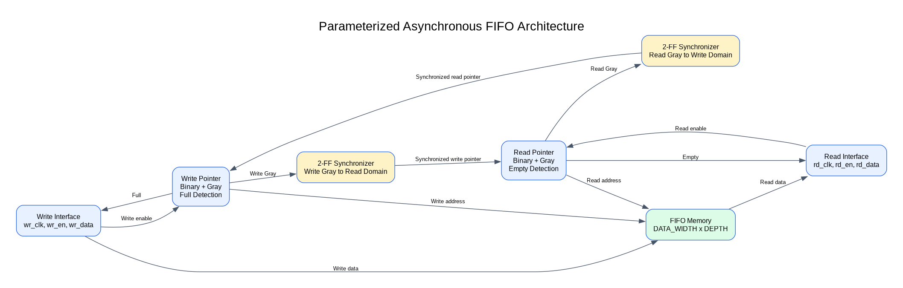
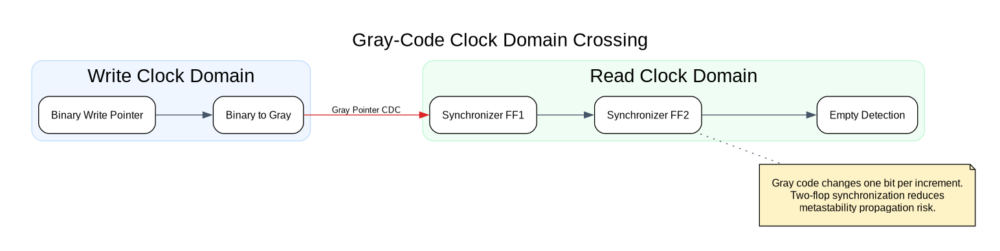
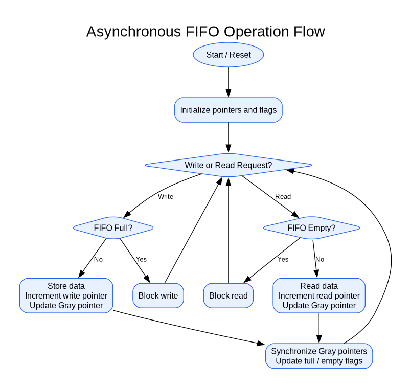

# Parameterized Asynchronous FIFO Using SystemVerilog

## Project Overview

This project implements a parameterized asynchronous FIFO
(First-In, First-Out) buffer using SystemVerilog.

It transfers data between two independent clock domains
using Gray-code pointers and two-flip-flop synchronizers.

## Features

- Independent write and read clocks
- Configurable data width and FIFO depth
- Binary and Gray-code pointers
- Two-stage CDC synchronizers
- Full and empty flag generation
- Overflow and underflow prevention
- Pointer wraparound
- Reset support
- Self-checking SystemVerilog testbenches
- Randomized scoreboard verification
- Parameterized configuration testing

## Architecture

## RTL Modules

| Module | Description |
|---|---|
| async_fifo.sv | Top-level FIFO |
| async_fifo_memory.sv | FIFO memory |
| async_fifo_write_ptr.sv | Write pointer and full detection |
| async_fifo_read_ptr.sv | Read pointer and empty detection |
| cdc_sync.sv | Two-stage synchronizer |
| bin_to_gray.sv | Binary-to-Gray converter |
| gray_to_bin.sv | Gray-to-binary converter |
| gray_pointer_counter.sv | Gray pointer counter |

## Tools

- SystemVerilog
- Icarus Verilog
- Verilator
- Yosys
- GTKWave
- Graphviz
- Python
- WSL Ubuntu

## Parameterized Verification Results

| configuration | data_width | addr_width | depth | transfers | status |
| --- | --- | --- | --- | --- | --- |
| C1 | 8 | 3 | 8 | 128 | PASS |
| C2 | 8 | 4 | 16 | 128 | PASS |
| C3 | 8 | 5 | 32 | 128 | PASS |
| C4 | 16 | 4 | 16 | 128 | PASS |
| C5 | 32 | 4 | 16 | 128 | PASS |

Total verified transfers: 640

## Synthesis Results

| configuration | data_width | addr_width | depth | storage_bits | total_cells |
| --- | --- | --- | --- | --- | --- |
| C1 | 8 | 3 | 8 | 64 | 7 |
| C2 | 8 | 4 | 16 | 128 | 7 |
| C3 | 8 | 5 | 32 | 256 | 7 |
| C4 | 16 | 4 | 16 | 256 | 7 |
| C5 | 32 | 4 | 16 | 512 | 7 |

Generic Yosys cell counts do not represent physical ASIC area.

## Running Verification

Run the Day 25 regression using:

    ./scripts/run_day25.sh

## Documentation

- [CDC Architecture](docs/day24_cdc_architecture.md)
- [Technical Architecture](docs/day26_architecture.md)
- [Final Project Report](docs/FINAL_PROJECT_REPORT.md)
- [Verification Summary](reports/final_verification_summary.md)

## Project Status

RTL design, functional verification, lint,
generic synthesis and documentation completed.
